<div align="center">

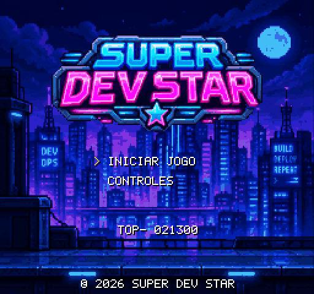

# Super Dev Star

**Um plataforma no estilo Super Mario Bros onde os heróis são devs e os inimigos são bugs.**

Corra pela cidade da tecnologia, tome café (ou Monster) para virar Sênior, ative o Firewall,
esmague bugs, chute vírus e faça o deploy no Data Center antes do tempo acabar.

🎮 **Jogue no navegador, no computador ou no celular. Sem instalar nada.**

</div>

---

<div align="center">
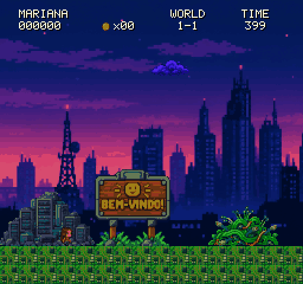
</div>

## Sobre o jogo

Super Dev Star recria a jogabilidade do Super Mario Bros do NES, com os **mesmos valores de física**:
aceleração, corrida, derrapagem, pulo mais alto quanto mais rápido você corre, quique ao pisar nos
inimigos e combos de pontos. Tudo foi transportado para o mundo da tecnologia:

| No Mario | No Super Dev Star |
|---|---|
| Mario pequeno / grande | **Dev Júnior** / **Dev Sênior** |
| Cogumelo | **Café**, **Monster** ou **Gema rosa** (cada dev tem o seu) |
| Flor de fogo | **Firewall**: atira pacotes de dados |
| Estrela | **Sudo Star**: invencibilidade de administrador |
| Cogumelo 1UP | **Backup** (disquete) |
| Goomba | **Bug** |
| Koopa e casco | **Vírus** e sua **cápsula** chutável |
| Bloco `?` | **Commit block** |
| Castelo | **Data Center** |

<table>
  <tr>
    <td>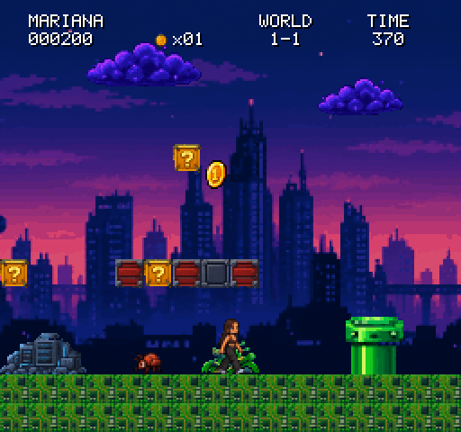</td>
    <td>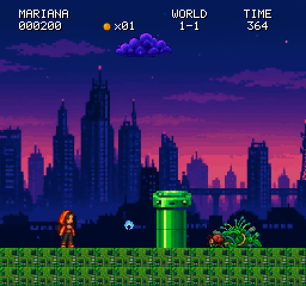</td>
  </tr>
  <tr>
    <td align="center"><sub>Commit blocks, moedas e bugs pelo caminho</sub></td>
    <td align="center"><sub>Com o Firewall, ela atira pacotes de dados</sub></td>
  </tr>
  <tr>
    <td>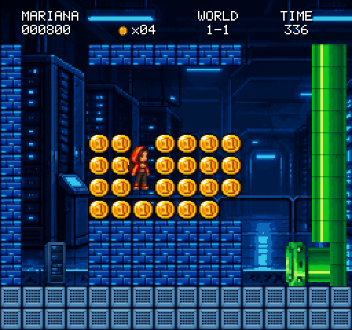</td>
    <td>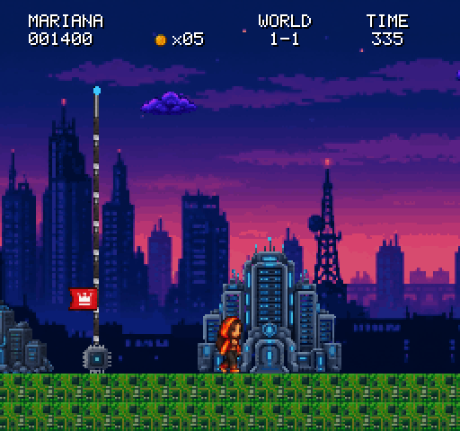</td>
  </tr>
  <tr>
    <td align="center"><sub>Sala bônus secreta: entre pelo duto e encontre a sala de servidores</sub></td>
    <td align="center"><sub>Desça a antena de deploy e entre no Data Center</sub></td>
  </tr>
</table>

## Personagens

Cada personagem é um dev de verdade, um amigo nosso. Todos têm a mesma física; muda o visual, a história e o item de poder.

<div align="center">
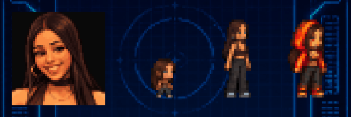

**MARIANA**, Front-end · HTML / JavaScript
<br><sub>Superpoder: faz piada de qualquer situação difícil e deixa o clima leve.</sub>
<br><sub><i>"Na minha máquina funciona!" · "Aí é mais caro!"</i></sub>
<br><sub>Vira Sênior com café ou Monster (sorteado a cada bloco). O Victor também.</sub>

<br><br>

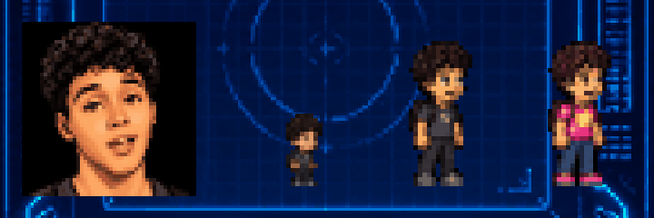

**DAVID**, QA · Petros e Brapoio
<br><sub>Superpoder: explica qualquer coisa difícil de forma simples.</sub>
<br><sub><i>"Deixa que eu resolvo" · "Yasss"</i></sub>
<br><sub>☕🚫 Não pode tomar café: vira Sênior com a <b>gema rosa</b> e precisa <b>desviar das canecas de café</b> que caem do céu.</sub>

<br><br>

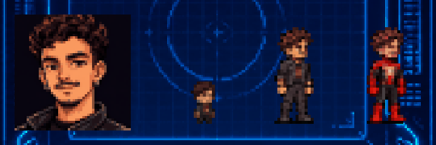

**VICTOR**, Desenvolvedor / Dados · Python / React / PowerBI
<br><sub>Superpoder: sobe qualquer pipeline ou automação do zero antes do café terminar.</sub>
<br><sub><i>"Vou automatizar isso aqui rapidinho."</i></sub>
</div>

<br>

<table>
  <tr>
    <td>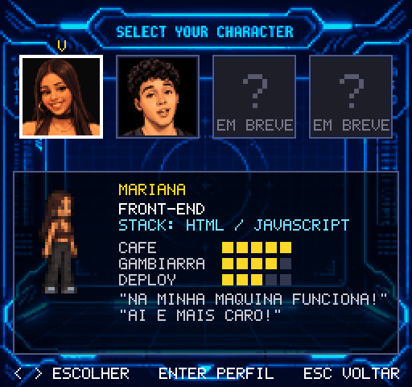</td>
    <td>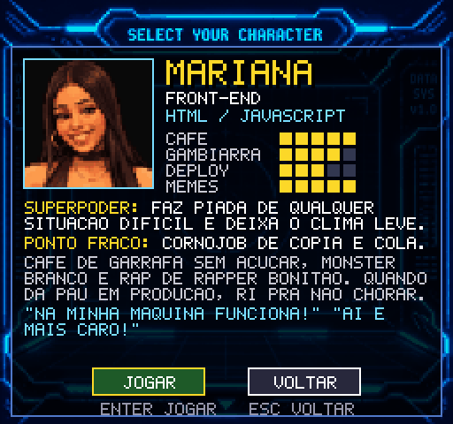</td>
  </tr>
  <tr>
    <td align="center"><sub>Escolha seu dev (mais devs chegando em breve)</sub></td>
    <td align="center"><sub>Perfil completo: atributos, superpoder e ponto fraco</sub></td>
  </tr>
</table>

## Fases

Depois de escolher o dev, você escolhe a fase. Cada fase é independente (começa com 3 vidas, Júnior e 0 pontos),
mas elas seguem a ordem: concluir uma libera a próxima. O progresso e o melhor resultado de cada fase ficam salvos no navegador.

| | |
|---|---|
| **1-1 HELLO WORLD**: a cidade da tecnologia à noite, com sala bônus secreta no subsolo | **1-2 LEGACY CODE**: dentro da sala de servidores, com teto de código legado, túnel cheio de bugs e saída pelo duto |
|  | 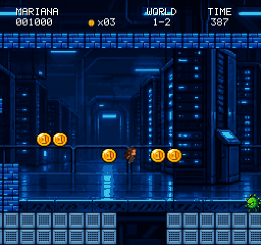 |
| **1-3 NEON GRID**: a cidade virtual em neon, com molas, plataformas flutuantes, espinhos, aranhas, drones e o portal no fim | |
| 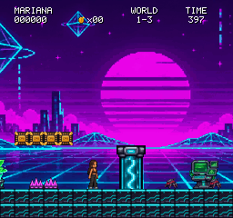 | |

## Funcionalidades

- 🕹️ **Física fiel ao Super Mario Bros** (valores originais do NES, rodando a 60 passos por segundo)
- ☕ **3 formas**: Júnior → Sênior (Café, Monster ou Gema rosa) → Firewall (levando dano, perde só o Firewall) (atira pacotes de dados); Sudo Star para invencibilidade
- 🐞 **Inimigos**: Bug (esmagável), Vírus (vira cápsula chutável, com combo de pontos), Aranha e Drone voador (fase 1-3)
- 🌀 **Fase neon**: molas, plataformas flutuantes, espinhos e checkpoint com poste que acende
- 🧱 Blocos `?`, tijolos quebráveis, bloco de várias moedas e blocos invisíveis
- 🚇 **Canos** com sala bônus, checkpoint no meio da fase e "hurry up" quando o tempo aperta
- 🚩 **Fim de fase clássico**: pontos pela altura no mastro, contagem do tempo e fogos de artifício
- ☕ **Evento do David**: canecas de café caem do céu (com aviso) e machucam; dá para desviar ou destruir com o Firewall
- 🪪 **Perfil de cada dev**: cargo, stack, atributos, superpoder, ponto fraco e frase típica
- 📱 **Celular em tela cheia, sem botões**: analógico invisível no lado esquerdo, toque e deslize no direito.
  Zoom bloqueado; pode ser instalado na tela inicial como app.
- 🎵 **Trilha sonora 8-bit original**: 8 músicas e 24 efeitos sintetizados por código, no estilo do chip do NES
- 🎮 Teclado e **controle de videogame** (Xbox / PlayStation)
- 🏆 Recorde salvo no navegador

## Como jogar

| Ação | Teclado | Controle |
|---|---|---|
| Mover | Setas / A D | D-pad / analógico |
| Pular | Z / Espaço / **↑** | A / ↑ |
| Correr | segure X / Shift | X |
| Atirar pacote (com Firewall) | X / Shift / C | X |
| Agachar / entrar no cano | ↓ | ↓ |
| Pausa (mostra os comandos) / confirmar | Enter | Start |
| Voltar ao menu | Esc | B |
| Tela cheia / som | F / M | |

**No celular** (o jogo entra em tela cheia no primeiro toque):

| Onde | Gesto | Ação |
|---|---|---|
| Lado **esquerdo** | arrastar o dedo para os lados | andar (mais longe = correr) |
| Lado **esquerdo** | arrastar para cima / para baixo | pular / agachar ou entrar no cano |
| Lado **direito** | tocar (segurar = mais alto) | pular |
| Lado **direito** | deslizar o dedo | lançar pacote (Firewall) |
| Placar (topo) | tocar | pausar |

> **Dicas:** segure **correr** para pular mais longe. Pise na cápsula do vírus para chutá-la contra
> os outros inimigos. Procure o cano que leva à sala bônus.

## Publicar online (GitHub Pages)

O repositório já vem com a publicação automática configurada. Depois de enviar para o GitHub, o jogo fica em:

```
https://SEU-USUARIO.github.io/super-dev-star/
```

Resumo (o passo a passo completo está em **[docs/DEPLOY_GITHUB.md](docs/DEPLOY_GITHUB.md)**):

```bash
gh auth login
```
```bash
git init -b main
```
```bash
git add .
```
```bash
git commit -m "Super Dev Star: primeira versao"
```
```bash
gh repo create super-dev-star --public --source=. --push
```
```bash
gh api -X POST repos/{owner}/super-dev-star/pages -f build_type=workflow
```
```bash
gh workflow run deploy-pages.yml
```

Depois disso, cada `git push` publica a versão nova sozinho. Para um link privado entre amigos,
há também o caminho pelo itch.io em [docs/PUBLICAR_WEB.md](docs/PUBLICAR_WEB.md).

## Rodar no seu computador

**Versão web** (recomendada, só precisa de Python):

```bash
python -m http.server 8080 --directory web
```

Depois abra http://localhost:8080.

**Versão desktop em C# / MonoGame** (precisa do .NET 8 SDK):

```bash
dotnet run
```

## Estrutura do projeto

```
SuperDevStar/
├─ web/                 versão web (HTML + JavaScript), a que vai para o GitHub Pages
│  ├─ index.html        página, botões de toque e manifesto de app
│  └─ js/               core, world, entities, scenes, main
├─ Core/ World/ Entities/ Scenes/ Characters/   versão desktop em C# (MonoGame)
├─ Assets/              imagens, fases e personagens (usados pelas duas versões)
├─ Imagens Geradas/     artes originais geradas por IA
├─ tools/               conversão das artes e build da versão web
├─ docs/                guias (arte, fases, publicação) e imagens deste README
└─ .github/workflows/   publicação automática no GitHub Pages
```

## Criando conteúdo

| Quero… | Como |
|---|---|
| Adicionar um amigo como personagem | 4 imagens em `Assets/Characters/<id>/` + um bloco em `characters.json` (o campo `powerups` escolhe o item: `coffee`, `monster`, `gem`; `coffeeHurts: true` liga as canecas caindo). Veja [docs/ASSETS.md](docs/ASSETS.md) |
| Criar uma fase nova | Um arquivo de texto em `Assets/Levels/`, onde cada letra é um bloco. Veja [docs/LEVEL_FORMAT.md](docs/LEVEL_FORMAT.md) |
| Mudar sons e músicas | Edite `tools/generate_audio.py` e gere de novo, ou aponte arquivos próprios no `Assets/Audio/audio.json`. Veja [docs/PUBLICAR_WEB.md](docs/PUBLICAR_WEB.md) |
| Converter artes geradas por IA | Coloque em `Imagens Geradas/` e use `tools/convert_generated_art.py` |

---

<div align="center"><sub>Feito com ☕ e muitos commits. Nenhum deploy foi feito numa sexta-feira durante o desenvolvimento.*</sub>
<br><sub>* quase nenhum.</sub></div>
